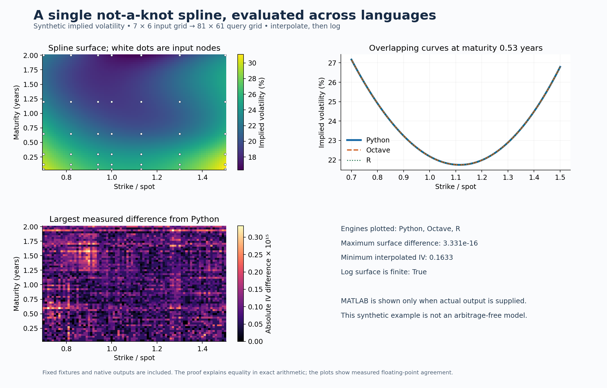

# Spline equivalence: MATLAB, Python, Octave and R

**The same not-a-knot tensor-product cubic spline, with a proof and reproducible
numerical evidence.**

This repository answers a specific porting question: can MATLAB
`interpn(...,'spline')` be reproduced in open-source languages? For a complete
rectilinear grid with at least four nodes on every axis, the underlying spline
is mathematically unique. The included Python and R implementations target that
same spline. **Actual MATLAB, Python, Octave and R executions have passed the
shared fixtures.** The first [GitHub workflow run](https://github.com/jeremevans/-spine/actions/runs/41390026607)
passed both jobs, including MATLAB R2025b Update 7. See [the CI evidence](docs/CI_RESULTS.md).

| Environment | Method used here | Delivered execution status |
| --- | --- | --- |
| MATLAB | `interpn(...,'spline',NaN)` | Passed in actual MATLAB R2025b Update 7 |
| Python / SciPy | `RegularGridInterpolator(method='cubic', solver=spsolve)` | Passed |
| GNU Octave | `interpn(...,'spline',NaN)` | Passed |
| R | Included tensor wrapper around `pracma::interp1(method='spline')` | Passed |

The one-dimensional cases use `interp1` in MATLAB/Octave. MATLAB's separate
`interpn(...,'cubic')` method is cubic convolution and is outside this project.

## What “prove” means here

1. **General mathematical proof:** derive the spline equations, prove their
   unique solution for arbitrary positive interval widths, then prove the
   tensor-product extension. See [docs/PROOF.md](docs/PROOF.md).
2. **Independent exact reference:** standard-library rational arithmetic verifies
   200 interpolation, continuity and endpoint equalities and computes 36 exact
   2D answers. The reference does not call SciPy interpolation.
3. **Actual runtime evidence:** 42 cases and 8,687 query points across 1D–4D,
   including every data basis vector on one 5×5 grid. Ten unit tests also check
   the comparator and its rejection of corrupted evidence.
4. **Actual MATLAB evidence:** the public-repository workflow ran MATLAB R2025b
   Update 7, exported its results and passed all 42 cases. The native JSON and
   comparison report are [preserved in the repository](evidence/github-actions-41390026607/).

An exact-arithmetic theorem and a floating-point test report make different
claims. This repository keeps both visible. Neither finite tests nor matching
function names prove identical behavior for all inputs or software versions.

## Measured results

Delivered run: 1 November 2026. Python 3.12.14, NumPy 2.3.5, SciPy 1.17.0,
Octave 8.4.0, R 4.3.3, pracma 2.4.4 and jsonlite 1.8.8.

| Comparison, all 42 cases | Largest absolute difference |
| --- | ---: |
| Python vs independent reference | 2.2204 × 10⁻¹⁵ |
| Octave vs independent reference | 4.2522 × 10⁻¹⁴ |
| R vs independent reference | 1.4988 × 10⁻¹⁵ |

All passed with matching NaN masks and the predeclared threshold
`2e-11 + 2e-10 * abs(reference)`. The largest Octave difference came from the
coordinate-scaling stress case. Passing means agreement within this threshold,
not bit-for-bit equality. Default iterative-solver diagnostics are reported
separately and do not define pass/fail for the direct-solver implementation.

These are the original local measurements. The later MATLAB GitHub run had a
maximum error of **2.0539 × 10⁻¹⁵** against the independent reference and a maximum
direct difference of **3.5527 × 10⁻¹⁵** from Python in that job.

Full details: [original local results](docs/RESULTS.md), [GitHub results](docs/CI_RESULTS.md),
native JSON outputs in [evidence/](evidence/), and [primary sources](docs/SOURCES.md).

## Quick start

From the repository root, with Python 3.11 or later:

```bash
python -m pip install -r requirements-tested.txt
python -m unittest discover -s tests -v
python scripts/verify.py --python-only
python examples/minimal.py
```

To include actual Octave and R executions, install those runtimes. On Ubuntu:

```bash
sudo apt-get update
sudo apt-get install -y --no-install-recommends octave r-base-core r-cran-pracma r-cran-jsonlite
python scripts/verify.py --require Octave R
python examples/volatility_surface.py --results results
```

On other platforms install Octave and R normally and run
`install.packages(c("pracma", "jsonlite"))` in R. Make `octave-cli` and `Rscript`
available on PATH. `verify.py` automatically runs available engines; `--require`
turns a missing engine into a failed run, so CI cannot silently skip a check.
Results go to the ignored `results/` directory. The delivered `evidence/`
snapshot stays unchanged.

## A small example with exact answers

```python
import numpy as np
from scipy.interpolate import RegularGridInterpolator
from scipy.sparse.linalg import spsolve

x = np.array([0, 1, 2, 4, 7.])
y = np.array([-2, 0, 1, 3, 4, 6.])
i, j = np.indices((5, 6))
V = (10 + ((i + 2) * (j + 3)) % 11) / 100
q = np.array([[1.5, .5], [3.25, 2.5], [6.75, 5.5]])

spline = RegularGridInterpolator(
    (x, y), V, method="cubic", solver=spsolve,
    bounds_error=False, fill_value=np.nan,
)
print(spline(q))
# [0.14892276 0.14584451 0.15269533]
```

The exact values are `838733/5632000`, `2031089/13926400` and
`10632481/69632000`. Runnable equivalents:

```bash
python examples/minimal.py
octave-cli --quiet examples/minimal.m
Rscript examples/minimal.R
```

In MATLAB, run `examples/minimal.m`. The examples assert against exact rational
answers rounded to floating point. The R wrapper is reusable via
`source('r/interpn_spline.R')`; the Python adapter can be installed with
`python -m pip install -e .` and imported as `spline_equivalence.interpn_spline`.

## Volatility-surface example



The example generates a smooth, positive surface with skew and term structure,
interpolates a 7×6 grid onto 81×61 query points, checks positivity, and takes the
natural log. The chart compares native Python/Octave/R results. It includes no
MATLAB curve unless actual MATLAB output is supplied.

`examples/volatility_surface.py` writes a figure and a NumPy archive containing
the interpolated IV and log-IV arrays. They are the data a later PCA/AR model
could consume. This example does not fit PCA or AR(1), claim historical market
data, or enforce option-price arbitrage constraints. A separate overshoot case
shows that positive inputs do not guarantee a positive spline.

Spline equivalence does not establish which interpolation method a particular
stochastic volatility surface paper used. Reproducing a published model also
requires matching its interpolation, log transformation, PCA inputs and factor
dynamics. The example here isolates the interpolation step.

To rebuild the delivered figure directly from saved engine outputs:

```bash
python examples/volatility_surface.py --results evidence
```

That command writes the figure and NumPy archive into `evidence/`; use a copy
if you want to preserve its bytes exactly.

## Run actual MATLAB

From the repository root in MATLAB:

```matlab
addpath('scripts');
run_engine('fixtures/splines.json','results/matlab.json');
```

Then in a terminal:

```bash
python scripts/verify.py --matlab-results results/matlab.json --require MATLAB
```

The importer checks engine identity, the fixture fingerprint, every case name,
the count of values, numerical differences, and missing masks. Preserve the
same fixture when moving results between computers. The identity checks protect
against accidental mix-ups; they are not cryptographic authentication of an
external MATLAB installation.

## GitHub project and automated verification

Project: [jeremevans/-spine](https://github.com/jeremevans/-spine).
See [GitHub Actions](https://github.com/jeremevans/-spine/actions) for current
workflow runs and downloadable evidence.

The workflow runs Python/Octave/R checks on pushes to `main`, pull requests and
manual dispatch. A second job uses MathWorks' official actions with MATLAB
R2025b in **public repositories**. Download the `matlab-evidence` artifact to
inspect the actual version, native results and comparison report. The delivered
`evidence/` directory is the original local run. Later GitHub runs provide
separate evidence; use their conclusions and artifacts to assess the tested
commit and runtime versions.

MathWorks currently documents automatic product licensing for public projects.
The MATLAB job is skipped in private repositories until separately licensed and
enabled. See [the official action documentation](https://github.com/matlab-actions/setup-matlab).

## Porting details that matter

- Keep axis order: `V[i,j]` corresponds to `(x[i],y[j])`; use NumPy
  `meshgrid(..., indexing='ij')` for full grids.
- The exchange format flattens data in MATLAB/R column-major order (`order='F'`
  in NumPy). Queries are explicit rows of paired coordinates.
- Octave's N-D spline vector queries have Cartesian-grid semantics. Its runner
  uses scalar native `interpn` calls for scattered paired queries and one full
  grid call for the surface example. MATLAB accepts paired query vectors.
- Use the same endpoint condition and outside-domain fill. Base R's default
  spline endpoint rule is not substituted for `pracma`'s method.
- Use finite real data, increasing axes and at least four nodes per axis for
  this common interface. Unsupported inputs raise an error.
- Preserve `log(interpolate(V))` if that is the original workflow.
  `interpolate(log(V))` is a different model. Check for nonpositive values first.

## Repository layout

| Path | Purpose |
| --- | --- |
| `src/spline_equivalence/core.py` | Adapter using SciPy |
| `src/spline_equivalence/reference.py` | Independent floating-point and exact-rational construction |
| `r/interpn_spline.R` | Explicit N-D R wrapper |
| `scripts/verify.py` | Execute engines, compare results and report |
| `scripts/run_engine.m`, `scripts/run_r.R` | Actual engine runners |
| `fixtures/splines.json` | Shared deterministic inputs with content fingerprint |
| `tests/` | Unit tests and deliberately incorrect controls |
| `examples/` | Minimal exact examples and the IV surface visualization |
| `docs/` | Proof, measured results and primary sources |
| `evidence/` | Original local results and separately preserved actual MATLAB CI evidence |

MIT-licensed project code and synthetic fixtures. Dependencies retain their own
licenses. No third-party proprietary implementation or historical quote data
is redistributed.
