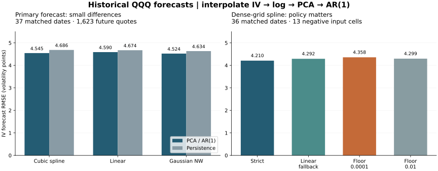

# Executed QQQ PCA / AR(1) forecasting results

**2 November 2026.** Python historical forecasts and sensitivities completed. The sample provides a reproducible comparison, not a reliable universal method ranking.

[Protocol and reproduction commands](FORECAST_PROTOCOL.md) · [Machine-readable Python evidence](../evidence/forecast-qqq-2026-11-02/python-summary.json.gz) · [Monthly losses](../evidence/forecast-qqq-2026-11-02/monthly-errors.csv)

## What was actually forecast

The source has 70 monthly snapshots. The first 24 define the initial training sample and a frozen 9×7 moneyness/maturity grid. Of 46 scheduled one-month forecasts for March 2013–December 2016, **37 are eligible**, and all methods score the same **1,623 next-month observed quotes**. Nine origins lack full support for the training-frozen domain; no future data were used to fill them. There are 61 complete aligned surfaces.

Every origin refits centered log-IV PCA and independent intercept-bearing AR(1) models on past factor scores. The primary model uses three components. IV is interpolated **before** taking its logarithm.

## Forecast accuracy against observed quotes

All IV errors below are **volatility percentage points**, not percentages of error.

| Interpolation | PCA/AR(1) RMSE | Persistence RMSE | Historical-mean RMSE | PCA score-RW RMSE | AR(1) MAE | Equal-month AR(1) RMSE |
|---|---:|---:|---:|---:|---:|---:|
| Cubic spline | 4.545053 | 4.685563 | 4.692748 | 4.661511 | 2.807020 | 3.922112 |
| Linear | 4.589586 | 4.673723 | 4.696770 | 4.664717 | 2.837987 | 3.965873 |
| Gaussian NW | 4.524022 | 4.634211 | 4.691868 | 4.638656 | 2.824046 | 3.904381 |

NW has the lowest pooled RMSE here, while spline has the lowest MAE. The three AR(1) methods improve modestly over their own persistence baselines in decimal-IV RMSE. Rankings depend on the loss: the historical-mean baseline has **lower log-IV RMSE** than AR(1) for all three methods. No method wins every criterion.

The paired six-calendar-month block-bootstrap intervals for differences between interpolation methods include zero. There are only 37 eligible temporal observations, not 1,623 independent forecast experiments. These exploratory intervals do not validate future skill.

| Equal-month MSE comparison (A minus B) | Difference, points² | Descriptive 95% interval |
|---|---:|---:|
| spline/pca_ar1 minus spline/persistence | -1.4189 | [-3.2833, -0.4849] |
| linear/pca_ar1 minus linear/persistence | -1.0669 | [-2.4467, -0.2253] |
| nadaraya_watson/pca_ar1 minus nadaraya_watson/persistence | -1.1687 | [-2.4973, -0.3856] |
| spline/pca_ar1 minus linear/pca_ar1 | -0.3452 | [-1.6024, 0.3209] |
| spline/pca_ar1 minus nadaraya_watson/pca_ar1 | 0.1388 | [-0.5812, 0.9512] |
| linear/pca_ar1 minus nadaraya_watson/pca_ar1 | 0.4840 | [-0.0765, 1.5006] |

## Factor stability

| Method | Three-PC variance explained, min–max | AR slope range | Fits with abs(slope) ≥ 1 |
|---|---:|---:|---:|
| Cubic spline | 98.52%–99.31% | -0.2583–0.9355 | 0 |
| Linear | 99.79%–99.88% | -0.0975–0.9171 | 0 |
| Gaussian NW | 99.77%–99.91% | -0.1185–0.8949 | 0 |

| Between-method comparison | Median PC1 angle | Median largest three-PC angle |
|---|---:|---:|
| spline/linear | 5.44° | 88.32° |
| spline/nadaraya_watson | 8.08° | 76.01° |
| linear/nadaraya_watson | 7.68° | 30.95° |

The leading component is fairly similar across methods, while the weaker higher components can occupy very different subspaces. High variance explained does not imply stable economic factor interpretations or strong forecast accuracy. Full consecutive-refit and cross-method diagnostics are preserved in [factor-stability.csv](../evidence/forecast-qqq-2026-11-02/factor-stability.csv).

## Sensitivity to model choices

The following all use the same 37 quote dates. These are reported alternatives, not test-selected settings for a claimed winner.

| Specification | Spline RMSE | Linear RMSE | Gaussian NW RMSE |
|---|---:|---:|---:|
| Primary: k=3, expanding | 4.545053 | 4.589586 | 4.524022 |
| k1 | 4.527064 | 4.563227 | 4.506610 |
| k2 | 4.534766 | 4.578801 | 4.512811 |
| k5 | 4.542916 | 4.593483 | 4.523172 |
| rolling24 | 5.112871 | 5.431094 | 5.200534 |
| nw_bandwidth_0.5 | 4.545053 | 4.589586 | 4.600096 |
| nw_bandwidth_2.0 | 4.545053 | 4.589586 | 4.475170 |
| grid_5x4 | 4.588554 | 4.642124 | 4.547059 |

The later-start (`initial36`) and dense-grid tests have different eligible date sets. Their JSON records include the primary result recalculated on matched dates; comparing their raw aggregate RMSE with all 37 primary dates would be misleading.

## Negative spline IV changes the forecasting problem

The primary 9×7 grid has no nonpositive fitted IV. On the same frozen domain, the 17×13 grid exposes **13 negative spline cells on 2014-03-03**, minimum **−0.0422029 decimal IV**. Strict handling removes that training row for every method and skips the following forecast origin, leaving 36 eligible dates.

The table below compares spline policies on the **same 36 dates**. Repaired policies can also issue a 37th forecast, excluded from this matched comparison.

| Dense-grid spline policy | Matched RMSE | Repaired cells | Unstable factor fits across full run |
|---|---:|---:|---:|
| Strict row rejection | 4.210498 | 0 | 0 |
| Linear fallback | 4.292361 | 13 | 0 |
| Floor 0.0001 | 4.358491 | 13 | 7 |
| Floor 0.01 | 4.298866 | 14 | 0 |

The 0.0001 floor creates **seven** factor fits with `abs(phi) >= 1`. No slope is capped. The 0.01 floor changes 14 cells, including one positive cell below the floor. Repairs change the model; they do not restore spline equivalence or guarantee sensible dynamics. Strict rejection has the smallest matched error here, but discards observed information and reduces forecast coverage.

The earlier reconstruction negative is recomputed separately: spline **−0.0439822**, observed and linear **0.01488**, at a coordinate outside this forecast domain. Flooring it at 0.0001 raises the reconstruction log-RMSE to **0.139225** on 1,903 quotes; linear fallback gives **0.078947**. The unrepaired log-RMSE **0.078968** uses only 1,902 positive pairs and has a different denominator. These are contemporaneous reconstruction results, **not** the forecast errors above.

## Separate reconstructed-surface target

| Method | AR(1) RMSE to its own next reconstructed surface | Months | Grid cells |
|---|---:|---:|---:|
| Cubic spline | 3.336442 | 34 | 2142 |
| Linear | 3.415297 | 34 | 2142 |
| Gaussian NW | 3.376731 | 34 | 2142 |

These method-dependent targets differ from one another. Use them to diagnose the fitted dynamics, not to rank market-quote forecasting methods.

## Executed numerical verification

[Successful GitHub Actions run](https://github.com/jeremevans/-spine/actions/runs/41528114577) at code commit `813b86dbcdb9330a7101f0fca736b7738d131568`: **41 tests passed**. Historical reconstruction regression also passed.

| Native engine vs Python | Aligned-IV max difference, 210 cases | Log-forecast max difference, 111 cases | AR-slope max difference |
|---|---:|---:|---:|
| Octave 8.4.0 | 2.776e-15 | 4.663e-15 | 1.715e-14 |
| R R version 4.3.3 (2024-02-29) | 1.749e-15 | 4.663e-15 | 2.998e-15 |

Projection matrices and explained-variance ratios also pass. The native PCA/AR(1) comparisons use shared Python-generated log matrices; interpolation is independently checked in a separate stage. This is numerical stage parity, not three independent ingestion/backtest implementations. **Historical MATLAB forecasting was not run.** The MATLAB-compatible runner and import validator are supplied; existing synthetic MATLAB passes do not verify these historical forecasts.

Local Python evidence preserves NOT RUN for local Octave/R/MATLAB; the [separate CI evidence](../evidence/forecast-qqq-2026-11-02/ci-native-summary.json) records the actual remote Octave/R execution. No local statuses were relabeled.

## Interpretation limits

This is 2011–2016 **QQQ ETF-call** research with narrow support and only 37 eligible one-month observations. It does not establish NDX 2000–2010 coverage, daily or multi-step skill, arbitrage freedom, trading profitability, or literal reproduction of an unavailable original MATLAB model. The historical sample was used during benchmark development; temporal isolation in the code does not turn an exploratory study into a preregistered statistical test.
