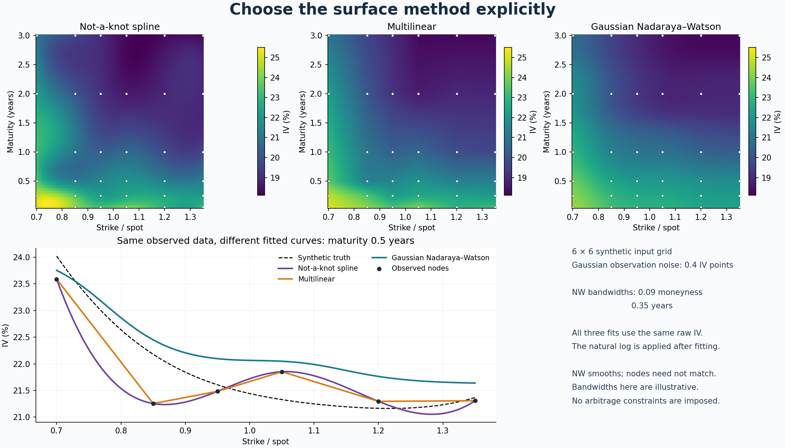

# Three selectable surface methods

The existing not-a-knot spline remains the default. The two additional options
are **multilinear grid interpolation** and **Gaussian Nadaraya–Watson (NW)**
local-constant regression. Cross-language agreement is checked within each
method. Different methods generally produce different surfaces.

| Property | `spline` | `linear` | `nadaraya_watson` |
| --- | --- | --- | --- |
| Input to the common interface | Complete rectilinear grid | Complete rectilinear grid | Complete rectilinear grid |
| Separate scattered-data interface | No | No | `nadaraya_watson(points, values, queries, bandwidth)` |
| Minimum grid nodes per axis in this interface | 4 | 2 | 2 (direct scattered API permits one observation) |
| Recovers observed node values | Yes, to numerical precision | Yes, to numerical precision | Generally no; it smooths |
| Smoothness within the domain | C² | Continuous, with slope changes across cells | Smooth Gaussian weighted mean |
| Positive observations remain positive | Not guaranteed | Inside the grid | Wherever the Gaussian estimate is evaluated |
| Extra parameter | Not-a-knot endpoint condition | None | Explicit positive bandwidth per coordinate |

The common cross-language grid policy fills outside queries with NaN/NA or an
explicit real scalar. Python additionally accepts `fill_value=None`; linear and
spline then extrapolate, and NW evaluates its Gaussian estimator outside the
grid. That optional Python behavior is not the common R/MATLAB fill interface.
The direct scattered NW functions in all languages evaluate outside the sample
bounding box, but far-away predictions have weak observational support.

## Python

```python
from spline_equivalence import interpolate_surface

linear_iv = interpolate_surface(axes, iv, queries, method="linear")
nw_iv = interpolate_surface(
    axes, iv, queries, method="nadaraya_watson", bandwidth=[0.08, 0.30]
)
spline_iv = interpolate_surface(axes, iv, queries)  # existing default
```

Here the coordinates are strike/spot and maturity in years. The bandwidths are
**0.08 in strike/spot and 0.30 years**, not variances or percentages. Queries are
rows of paired coordinates; `iv[i,j]` corresponds to `axes[0][i], axes[1][j]`.
Install with `python -m pip install -e .`; the examples also work from source.

For irregular observations, bypass the complete-grid interface:

```python
from spline_equivalence import nadaraya_watson
nw_iv = nadaraya_watson(observed_coordinates, observed_iv, queries,
                       bandwidth=[0.08, 0.30])
```

## MATLAB, Octave and R

```matlab
addpath('matlab');
linear_iv = interpolate_surface({m, t}, iv, q, 'linear', [], NaN);
nw_iv = interpolate_surface({m, t}, iv, q, 'nadaraya_watson', [.08, .30], NaN);
```

```r
source("r/interpolate_surface.R")
linear_iv <- interpolate_surface(list(m, t), iv, q, method="linear")
nw_iv <- interpolate_surface(list(m, t), iv, q,
                            method="nadaraya_watson", bandwidth=c(.08, .30))
```

R and MATLAB/Octave grid values use column-major order. MATLAB/Octave linear
evaluation calls native `interp1` in 1D and `interpn` in higher dimensions; R
contracts the piecewise linear cardinal weights. NW is explicit project code
in all languages, not a newly discovered native MATLAB `interpn` method.

## What the calculations mean

Within a grid cell, multilinear interpolation sums the 2ᴰ corner values using
products of fractional distances along the axes. These weights are nonnegative
and sum to one inside the cell. This specifies a unique multilinear function
with those corner values. In 2D it includes an `xy` term; triangulated scattered
linear interpolation is a different construction.

For observations `(x_i, y_i)` and positive bandwidths `h_j`, NW computes

$$\widehat f(q)=\frac{\sum_i w_i(q)y_i}{\sum_i w_i(q)},\qquad
w_i(q)=\exp\left[-\frac12\sum_j\left(\frac{q_j-x_{ij}}{h_j}\right)^2\right].$$

Bandwidths are Gaussian standard deviations. A scalar applies the same numeric
width to every coordinate; an explicit vector makes coordinate units clearer.
The common kernel normalization cancels from the ratio. Observations have equal
prior weight; duplicate rows count as repeated observations. There are no vega
weights, volume weights, missing-value imputation or automatic bandwidth choices.

Larger bandwidths generally smooth more; smaller ones concentrate weight on
nearby observations. Subtracting the largest log weight before exponentiating
avoids an all-zero denominator from ordinary underflow. Distances that overflow
floating-point arithmetic are rejected rather than silently changing estimators.
Python processes query blocks to limit the working distance-matrix size.

Matching coordinates, bandwidths and observation weights specifies the same NW
formula across languages. This is distinct from spline uniqueness. The tests
compare both new methods with separate **50-digit Decimal references**, including
uneven grids, 1D–4D cases, anisotropic bandwidths, duplicates and underflow stress.

## Volatility, logs and bandwidth selection

Preserve the original pipeline: fit the **raw IV**, check finite positive results,
then take the natural log before the chosen PCA/factor workflow. Fitting log IV
first and exponentiating changes the model. Neither positivity nor a smooth
surface alone ensures absence of option-price arbitrage. This project still
does not fit PCA or AR(1).

The example bandwidths are illustrative. Choose units and bandwidths explicitly,
evaluate sensitivity, and estimate any tuning parameters using training data
only when assessing forecast performance. Changing the interpolation or smoothing
method changes the log-surface data, so refit the downstream model.

Run the same-data examples and comparison:

```bash
python examples/method_options.py
Rscript examples/method_options.R
octave-cli --quiet examples/method_options.m
python examples/compare_methods.py --bandwidth 0.09 0.35
python scripts/verify_methods.py --require Octave R
```

`compare_methods.py` writes a figure, a JSON report and an NPZ archive with all
three fitted IV and log-IV surfaces. The data and noise are synthetic; the
reported errors are demonstration results, not a claim that one method is best.



## Primary references and naming traps

- [MathWorks interpn](https://www.mathworks.com/help/matlab/ref/interpn.html): native grid linear interpolation and explicit outside fills.
- [SciPy 1.17 RegularGridInterpolator](https://docs.scipy.org/doc/scipy-1.17.0/reference/generated/scipy.interpolate.RegularGridInterpolator.html): rectilinear grid methods and boundary policy.
- [statsmodels KernelReg](https://www.statsmodels.org/stable/generated/statsmodels.nonparametric.kernel_regression.KernelReg.html): NW is `reg_type='lc'`; the default `ll` is local-linear regression, which is different. Its regression label is also unrelated to multilinear grid interpolation.
- [R stats::ksmooth](https://stat.ethz.ch/R-manual/R-devel/library/stats/html/ksmooth.html): its bandwidth is scaled by kernel quartiles, unlike the standard-deviation convention here. For a normal kernel, matching scale would require approximately `2.697959 * h`; the same numeric argument is not equivalent. This project uses its explicit N-D implementation rather than claiming a drop-in `ksmooth` match.
